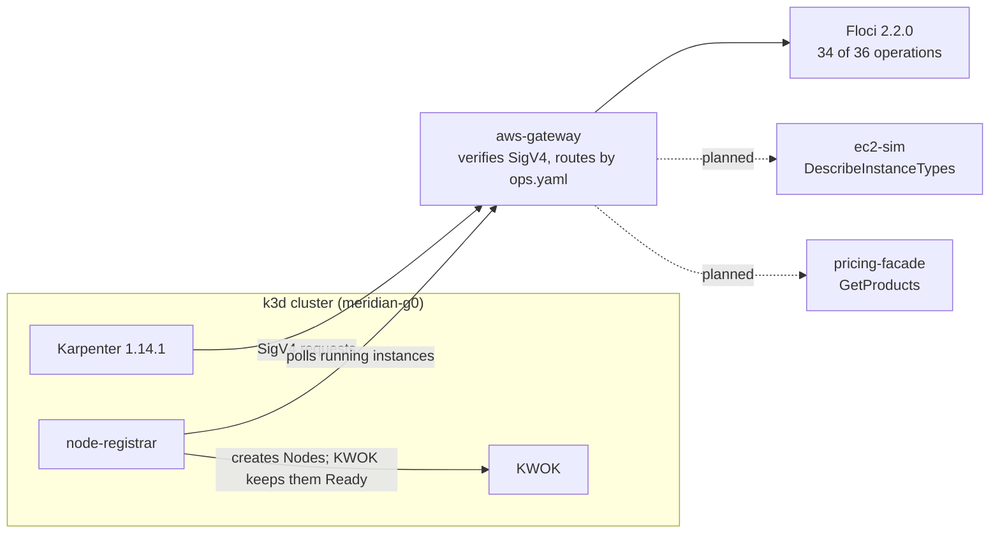

# Meridian

Meridian is a simulated AWS plane that lets unmodified Karpenter provision nodes on a laptop, so platform teams can test autoscaling without an AWS account or a cloud bill.

> **Not validated against real AWS.** Meridian never contacts AWS. Every response comes from a simulated AWS plane.

## What is proven today

Gate G0, the Karpenter proof gate, is **in progress**. The gate does not pass yet.

- Real, unmodified Karpenter 1.14.1 runs on a local k3d cluster against the simulated plane.
- By hand on the live stack, Karpenter launched an instance through `CreateFleet`, received a KWOK-backed Node, scheduled a pod on it, and tore it down. That covers criteria 1-3 of 8. The record is in [docs/s0/criterion3.md](docs/s0/criterion3.md).
- A contract probe checked Floci 2.2.0 against the 36 operations in [ops.yaml](ops.yaml): 35 of 37 checks passed. Floci serves 34 operations. Two need small custom backends ([docs/s0/decision.md](docs/s0/decision.md)).
- The stack used about 840 MiB with one node. Peak memory is not measured yet.

## Why this exists

Karpenter talks to EC2, IAM, SQS, SSM, EKS, and Pricing. Testing its behavior against real AWS costs money and needs credentials. A local stack must answer exactly the calls Karpenter makes, and it must say so when it cannot.

Meridian puts a SigV4-verifying gateway in front of one or more backends and routes each AWS operation to the backend that passed a contract probe. Karpenter is the oracle: if it provisions and removes nodes, the simulation is good enough for that purpose.

## Status

| Component | Status |
|---|---|
| `aws-gateway`: SigV4 verification, per-operation routing from `ops.yaml` | Done, tested |
| Trace recorder and `awscall` client | Done, tested |
| S0 contract probe and decision script | Done, tested |
| Floci 2.2.0 backend for 34 of 36 operations | Done |
| `node-registrar` and vendored KWOK (instances become Nodes) | Done, tested |
| Karpenter 1.14.1 on k3d, criteria 1-3 of 8 | Done by hand on the live stack |
| Reference-data `ec2-sim` (`DescribeInstanceTypes`) | In progress |
| `pricing-facade` (`pricing:GetProducts`) | In progress |
| Applying the approved routing table to `ops.yaml` | Planned (needs the two services above) |
| Spot interruption (`simctl`) | Planned |
| Isolated, no-internet gate stack | Planned |
| `make gate-karpenter` and the eight-criteria gate test | Planned |
| CI | Planned |

## Architecture



1. Karpenter sends signed AWS API calls to `aws-gateway`.
2. The gateway rejects calls with a bad signature, then looks up the operation in [ops.yaml](ops.yaml) and proxies it to the named backend.
3. Floci answers EC2, IAM, SQS, SSM, EKS, and STS calls in metadata-only mode. It launches no containers.
4. `node-registrar` watches for running instances and registers a Node for each one. KWOK marks those Nodes Ready, so pods schedule.
5. Today `ops.yaml` still routes every operation to Floci. The two failing operations move after their backends exist.

## Quick start

Prerequisites: Go 1.24, Docker, `k3d` v5.9.0 on `PATH`, `helm`, `openssl`, `python3`. Pinned component versions are in [versions.yaml](versions.yaml).

Stack resources: about 840 MiB with one node on an Apple-silicon Docker VM (7.65 GiB). Peak memory is not measured.

```sh
make init            # generate random local credentials into .env (no default keys)
make env-images      # render versions.yaml into .env.images
make build           # build the binaries into bin/
make build-linux     # build static Linux binaries for the containers
make test            # run the Go tests (no Docker)

make s0-up           # needs Docker: Floci, gateway, k3d cluster, Karpenter
make kwok-up         # needs Docker: apply vendored KWOK to the cluster
make deploy-registrar  # needs Docker: build and deploy node-registrar
make s0-probe        # needs Docker: run the contract probe, write docs/s0/report.{md,json}
make s0-decide       # print the per-operation backend decision (no Docker)
make s0-down         # needs Docker: delete the cluster and the stack
```

`make s0-up` does not install `k3d` for you. The workloads that exercise Karpenter are in [deploy/workloads/](deploy/workloads/); [docs/s0/criterion3.md](docs/s0/criterion3.md) shows the manual run.

## Repository layout

| Path | Contents |
|---|---|
| `cmd/aws-gateway`, `internal/gateway`, `internal/awsapi` | The gateway and SigV4 verification |
| `ops.yaml`, `internal/ops` | Operation-to-backend routing table and loader |
| `cmd/s0probe`, `internal/s0probe`, `scripts/s0matrix.py` | Contract probe and backend decision |
| `cmd/node-registrar`, `internal/noderegistrar` | Instances to KWOK-backed Nodes |
| `internal/trace`, `cmd/awscall`, `internal/awscall` | Call recording and a small AWS client |
| `internal/catalog` | Region data: AZs, instance types, ENI limits, prices |
| `deploy/` | Compose file, Karpenter values, vendored KWOK, workloads |
| `scripts/` | Cluster, seeding, and test-harness scripts |
| `docs/s0/` | Probe report, backend decision, criterion 3 record |

## Design decisions

- **One routing table.** [ops.yaml](ops.yaml) names the backend for each of 36 operations. The gateway, the probe, and the decision script all read it.
- **The probe picks the backend.** `make s0-decide` compares probe results per operation. A probe pass means a backend is eligible, not correct.
- **Karpenter is the oracle.** The gate asks whether real Karpenter provisions and removes nodes, not whether responses match a specification.
- **Floci runs in metadata-only mode.** EC2 and EKS mock mode are on, and Floci has no Docker socket. `scripts/check-no-sock.sh` fails `make s0-up` if any Compose service mounts one.
- **Secure defaults.** `make init` generates random credentials. The gateway verifies SigV4 on every call, refuses non-loopback listen addresses outside a container, and publishes its port on `127.0.0.1` only. It runs read-only, as a non-root user, with all capabilities dropped. The k3s containers run privileged, which k3s in Docker requires ([docs/s0/harness.md](docs/s0/harness.md)).

## Testing

Every package except `cmd/node-registrar` has unit tests. The gateway, SigV4, `awscall`, probe, trace, and versions packages also have adversarial tests. Five packages have Go fuzz targets (`internal/awsapi`, `internal/awscall`, `internal/gateway`, `internal/s0probe`, `internal/trace`).

```sh
make test            # go test ./...
make test-scripts    # Python tests for the tooling scripts
make lint-versions   # fail on any unpinned entry in versions.yaml
```

Go tests need no Docker.

## Pinned versions

| Component | Version |
|---|---|
| Karpenter | 1.14.1 |
| k3s | v1.35.9-k3s1 |
| k3d | v5.9.0 |
| KWOK | v0.8.0 |
| Floci | 2.2.0 |
| Go (build image) | 1.24.13 |

Images are pinned by digest in [versions.yaml](versions.yaml).

## More documentation

See [docs/s0/](docs/s0/): [decision.md](docs/s0/decision.md), [report.md](docs/s0/report.md), [criterion3.md](docs/s0/criterion3.md), [harness.md](docs/s0/harness.md).
