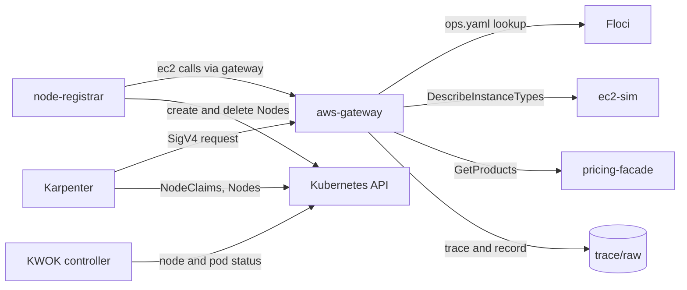

# Architecture

Meridian has four parts: a gateway, one or more AWS backends, a node controller, and an unmodified Karpenter. Karpenter believes it talks to AWS. Everything else exists to make that belief hold.

## Components

| Component | Source | Job |
|---|---|---|
| Karpenter 1.14.1 | Helm chart, `deploy/karpenter-values.yaml` | The system under test. `AWS_ENDPOINT_URL` points every SDK call at the gateway. |
| `aws-gateway` | `cmd/aws-gateway`, `internal/gateway` | Verifies SigV4, identifies the operation, routes it to a backend. |
| Floci 2.2.0 | pinned image | Backend for 34 of the 36 operations in `ops.yaml`. |
| `ec2-sim`, `pricing-facade` | `cmd/ec2-sim`, `internal/ec2sim`, `cmd/pricing-facade`, `internal/pricingfacade` | Backends for the two operations Floci fails: `DescribeInstanceTypes` and `pricing:GetProducts`. See [[The S0 Spike]]. |
| `node-registrar` | `cmd/node-registrar` | Creates a Node for each running instance and deletes it on termination. |
| KWOK 0.8.0 | `deploy/kwok` | Keeps those Nodes Ready and marks their pods Running. |
| k3d cluster `meridian-g0` | `scripts/k3d-up.sh` | Hosts Karpenter, KWOK and the registrar (k3s v1.35.9). |

## Request flow

Each backend arrow is a route in `ops.yaml`. Compose starts `ec2-sim` and `pricing-facade` only when `ops.yaml` routes an operation to them.

## One launch, step by step

1. A pod is Pending. Karpenter creates a NodeClaim and calls `ec2:CreateFleet` through the gateway.
2. The gateway checks the signature, reads the operation, finds `ec2:CreateFleet` in `ops.yaml`, and forwards to the backend named there.
3. Floci records a running instance. It starts no container because it has no Docker socket ([[Findings About Floci]]).
4. `node-registrar` polls `ec2:DescribeInstances` every 2 seconds, sees the instance, and creates a Node with the instance's `providerID`.
5. Karpenter matches the Node to the NodeClaim and marks it registered and initialized. KWOK marks the Node Ready.
6. The scheduler places the pod. KWOK sets it Running. See [[Nodes Without Machines]] for the measured timeline.

Termination runs the same path backwards: Karpenter calls `ec2:TerminateInstances`, and the registrar removes the Node.

## Network layout

Floci publishes no port. The gateway publishes `127.0.0.1:4566` only. The k3d cluster joins the Compose network `meridian`, so pods reach the gateway as `aws-gateway:4566`. Details are in [[Security Model]].

## Why this shape

- One gateway means one place to enforce authentication and one place to record which calls Karpenter makes.
- A per-operation backend choice lets a weak backend be replaced for one operation without touching the rest. See [[The Gateway and ops.yaml]].
- KWOK nodes avoid real machines, so the stack runs in under 1 GiB of memory (about 840 MiB measured with one running pod).
